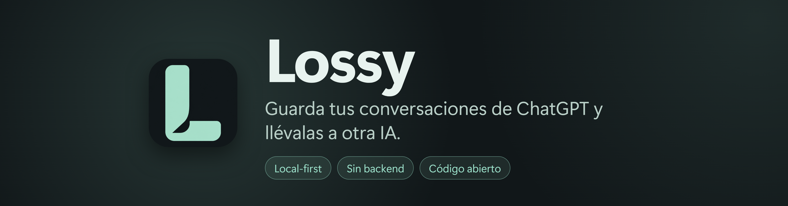
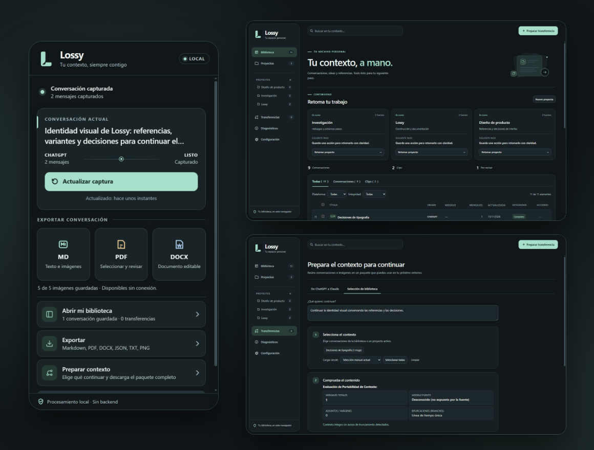

  

  <a href="README.md">English</a> · <strong>Español</strong>

**Tus conversaciones de ChatGPT, listas para la siguiente IA que uses.**

Lossy guarda tus conversaciones de ChatGPT en tu navegador, las organiza en proyectos y prepara el contexto que necesitas para seguir en otro lugar, como Claude. Cada exportación incluye enlaces a su origen y un recibo de integridad, así que siempre sabes qué llevaste contigo.

  

## Qué puedes hacer

- Guardar una conversación de ChatGPT con un clic, incluidas sus imágenes.
- Organizar las conversaciones en proyectos con objetivo, decisiones, preguntas abiertas y siguiente paso.
- Exportar a Markdown, PDF, Word, PNG, JSON o TXT, con imágenes y enlaces a su origen.
- Preparar un paquete de contexto para Claude u otra IA, con resumen y recibo de integridad.
- Buscar en todo lo que guardaste. La búsqueda se hace en tu equipo.

## Tus datos se quedan contigo

- Sin backend, sin telemetría y sin servidores que reciban tu historial.
- Lossy no tiene cuentas propias.
- Las credenciales de tu sesión solo se usan mientras se ejecuta una acción. Nunca se guardan ni se exportan.
- Todo lo que guardas vive en tu navegador.

## Empieza en minutos

1. Descarga este repositorio como ZIP o clónalo.
2. Abre `chrome://extensions` y activa el **Modo de desarrollador**.
3. Pulsa **Cargar descomprimida** y elige la carpeta `extension`.
4. Recarga tu pestaña de ChatGPT y abre Lossy desde el menú de extensiones.

## Conviene saber

- Lossy se abre en inglés. Puedes cambiar a español en Configuración.
- Lossy es un proyecto independiente. No está afiliado a OpenAI ni a Anthropic.
- La captura en vivo funciona con ChatGPT. Si ChatGPT cambia sus páginas internas, Lossy lee la página en su lugar, o puedes importar tu exportación oficial de ChatGPT.

## Licencia

Distribuido bajo la [licencia MIT](LICENSE).
