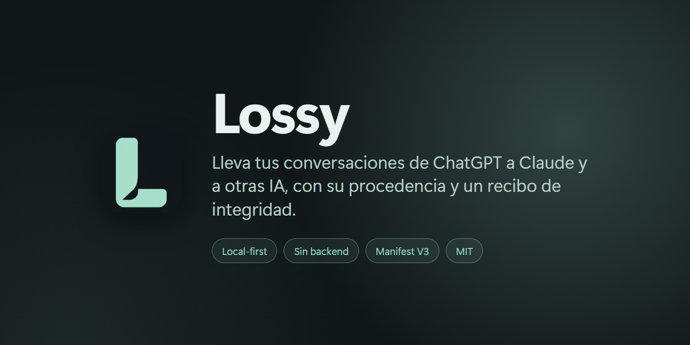
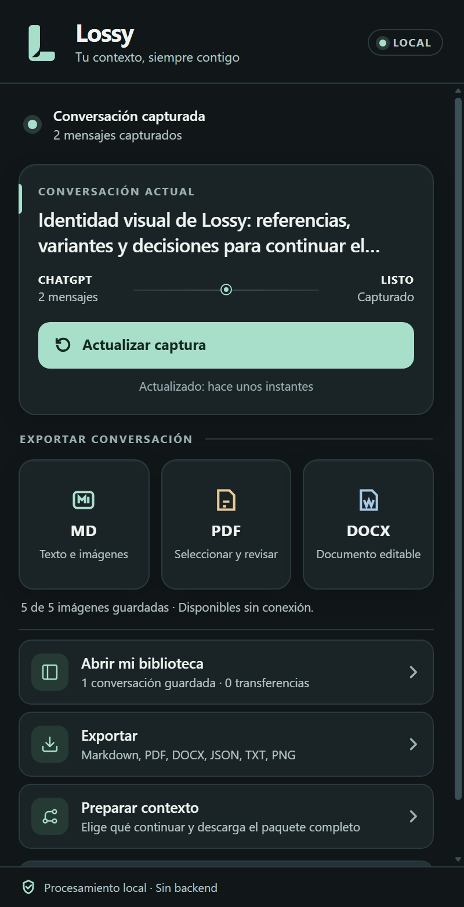
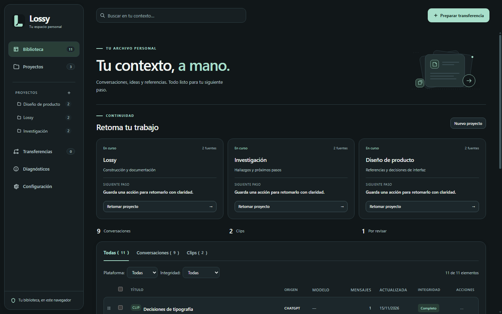
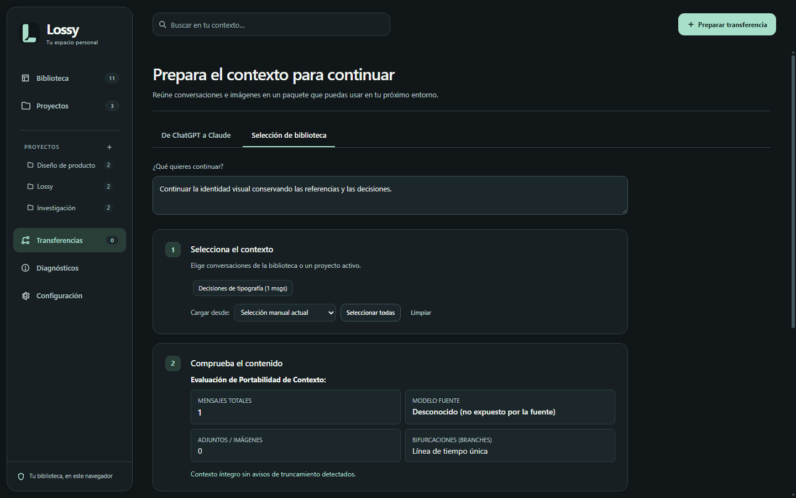

<p align="center">
  
</p>

**Lossy** guarda tus conversaciones de ChatGPT en tu navegador y prepara su contexto para continuar en Claude u otro entorno de IA. Cada exportación lleva su procedencia y un recibo de integridad.

Es una extensión de Chrome (Manifest V3) sin backend. Todo ocurre en tu equipo.

## Qué hace

- Captura conversaciones de ChatGPT desde la sesión activa. Si las rutas internas no están disponibles, lee el DOM de la página. También importa las exportaciones oficiales de ChatGPT (ZIP o `conversations.json`), incluidas sus imágenes.
- Guarda todo en IndexedDB, en tu equipo. La búsqueda también es local.
- Exporta a Markdown, JSON, TXT, PDF, DOCX y PNG, con imágenes y enlaces de procedencia.
- Prepara paquetes para continuar en Claude u otro destino: conversaciones por partes, imágenes aparte, un resumen de contexto y un recibo con SHA-256.
- Organiza proyectos con objetivo, decisiones, preguntas abiertas y siguiente paso. Un proyecto se puede respaldar en ZIP y restaurar después.

La guía de uso y el historial de versiones están en [extension/README.md](extension/README.md).

## Capturas

<p align="center">
  
</p>





Las capturas usan conversaciones de ejemplo, no datos reales.

## Privacidad

- No hay backend, telemetría ni subida del historial a servidores externos.
- Los tokens de sesión existen solo en memoria, durante cada operación. No se guardan en IndexedDB, en `chrome.storage` ni en los archivos exportados.
- Los diagnósticos eliminan tokens, cabeceras de autorización, cookies y correos antes de mostrarse.
- Las pruebas usan conversaciones sintéticas, no cuentas reales.

## Instalación

1. Clona este repositorio o descarga el ZIP.
2. Abre `chrome://extensions` y activa **Modo de desarrollador**.
3. Pulsa **Cargar descomprimida** y elige la carpeta `extension/`.
4. Recarga la pestaña de ChatGPT y abre Lossy desde el icono de extensiones.

## Pruebas

Requisitos: [Node.js](https://nodejs.org/), probado con la versión 26.

```bash
npm test
```

Las pruebas unitarias están en `tests/extension/*.test.js` y no necesitan navegador. `tests/run_all.js` ejecuta cada archivo en su propio proceso de Node y termina con error si alguno falla.

Las pruebas de navegador (`test:extension:e2e`, `:projects`, `:documents`, `:visual` y `:popup`) usan Playwright y Chromium. Este repositorio no instala esas herramientas. Antes de ejecutarlas, define estas variables si lo necesitas:

| Variable | Para qué sirve |
| --- | --- |
| `LOSSY_QA_MODULES` | Carpeta con `playwright` y, según la prueba, `sharp` y `pdfjs-dist`. Por defecto, `node_modules`. |
| `LOSSY_QA_BROWSER_PATH` | Directorio donde Playwright guarda sus navegadores. |
| `LOSSY_QA_POPPLER` | Ruta a `pdftoppm` para la comprobación de PDF. Si no se define, se usa el que esté en el `PATH`. |

Los resultados se escriben en `scratch/`, que no se versiona.

## Estructura

```
extension/
├── manifest.json        Manifest V3
├── icons/               Iconos y logotipo
├── src/
│   ├── background/      Service worker
│   ├── content/         Script de contenido para chatgpt.com
│   ├── core/            Modelo canónico, almacenamiento, exportación y paquetes
│   ├── platforms/       Adquisición de ChatGPT (API interna y DOM)
│   ├── targets/         Adaptadores de destino (genérico, Claude, Markdown)
│   ├── popup/           Ventana emergente
│   ├── workspace/       Biblioteca, proyectos y transferencias
│   └── documents/       Editor de documentos para PDF y Markdown
└── vendor/              markdown-it 15.0.3 y KaTeX 0.19.1 (licencias MIT incluidas)
docs/                    Banner y capturas de este README
tests/
├── run_all.js           Ejecuta las pruebas unitarias
└── extension/           Pruebas unitarias (node:test) y de navegador
```

## Limitaciones

- Lossy es un proyecto independiente. No está afiliado a OpenAI ni a Anthropic.
- La captura en vivo solo funciona con ChatGPT. Claude y Markdown son destinos de paquetes, no fuentes de captura.
- Las rutas internas de ChatGPT pueden cambiar sin aviso. Si dejan de funcionar, la captura pasa al DOM o puedes importar la exportación oficial.
- Lossy no crea chats, proyectos ni conectores en Claude. Prepara archivos que tú adjuntas.

## Licencia

Distribuido bajo la [licencia MIT](LICENSE). Las dependencias incluidas en `extension/vendor/` conservan sus propias licencias MIT.
