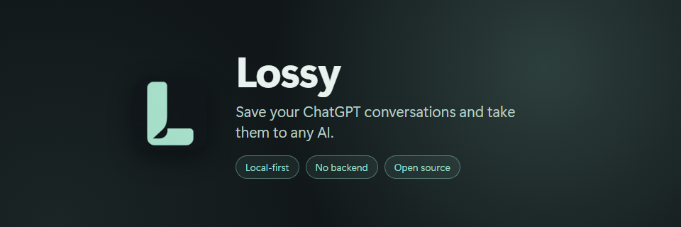
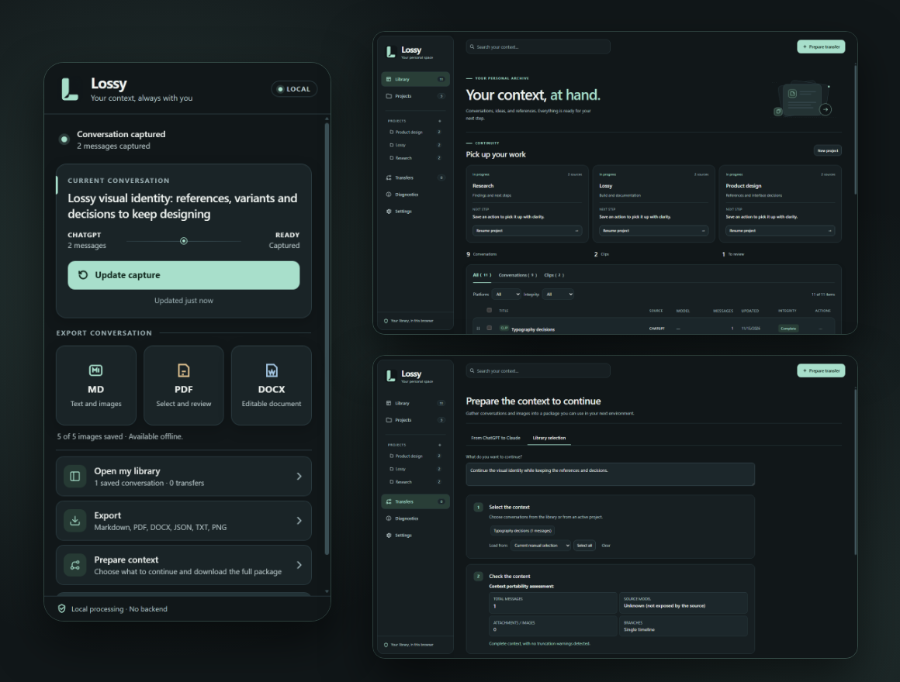

  

  <strong>English</strong> · <a href="README.es.md">Español</a>

**Your ChatGPT conversations, ready for the next AI you use.**

Lossy keeps your ChatGPT conversations in your browser, organizes them into projects, and packs the context you need to continue somewhere else, such as Claude. Every export includes links to its source and an integrity receipt, so you always know exactly what you carried over.

  

## What you can do

- Save a ChatGPT conversation with one click, images included.
- Keep every project in order: its goal, its decisions, its open questions, and a clear next step, all in one place.
- Export to Markdown, PDF, Word, PNG, JSON, or TXT.
- Search runs on your device.
- Send your context to Claude or another AI as a pack: a summary plus an integrity receipt that shows exactly what you carried over.

## Your data stays yours

- No backend, no telemetry, no servers that receive your history.
- Lossy has no accounts of its own.
- Session credentials live in memory only while an action runs. They are never saved or exported.
- Everything you save stays in your browser.

## Get started

1. Download this repository as a ZIP, or clone it.
2. Open `chrome://extensions` and turn on **Developer mode**.
3. Click **Load unpacked** and choose the `extension` folder.
4. Refresh your ChatGPT tab and open Lossy from the extensions menu.

## Good to know

- Lossy follows your browser language. The interface is available in English and Spanish.
- Lossy is an independent project. It is not affiliated with OpenAI or Anthropic.
- Live capture works with ChatGPT. If ChatGPT changes its internal pages, Lossy reads the page instead, or you can import your official ChatGPT export.

## License

Released under the [MIT license](LICENSE).
